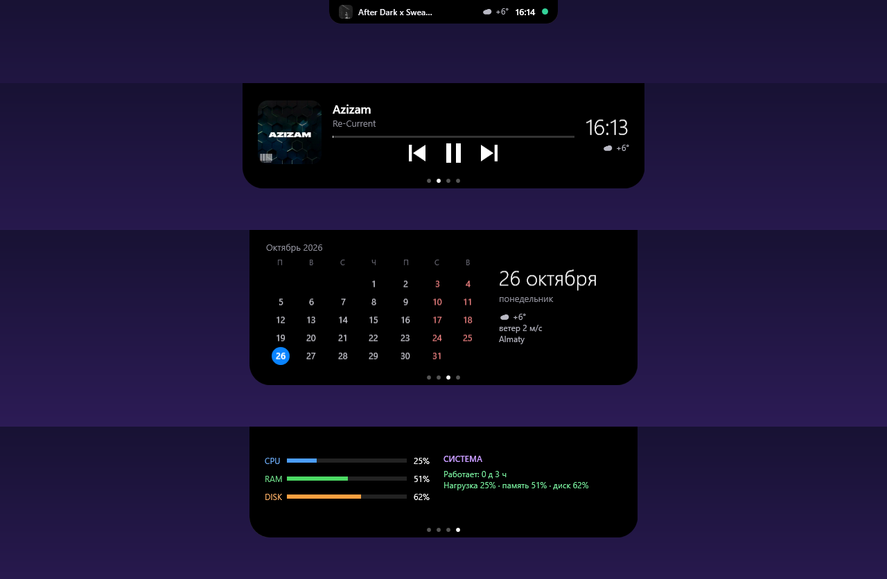

<div align="center">

# 🏝️ Windows Dynamic Island

**A Dynamic Island / notch for your Windows desktop.** Now-playing music with controls, calendar, weather, CPU/RAM/disk and optional server status — in a smooth, animated pill that sticks to the top of your screen.


[Install](#-install-30-seconds) · [Features](#-features) · [Configuration](#-configuration) · [Русский](#-по-русски)

</div>

---

## ✨ Features

- **Real Dynamic Island look** — flat top glued to the screen edge with curved "ear" corners, rounded bottom, no shadow, smooth spring animation on expand / collapse.
- **Now playing** — works with **any** player (Spotify, YouTube Music, Yandex Music, browsers, VLC…) through the Windows media session. Cover art, title, artist, progress, ⏮ ⏯ ⏭ buttons.
- **Calendar** — current week strip and a full month, today highlighted.
- **Weather** — current temperature and wind from [Open-Meteo](https://open-meteo.com) (no API key). Location is detected by IP or set manually.
- **System** — live CPU / RAM / disk load and uptime.
- **Your server status (optional)** — point it at any JSON endpoint and see load, services up/down and errors. A green/red dot sits in the collapsed pill.
- **📌 Pin window** — a pushpin button next to the media controls keeps the window you were just using on top of all others (click again to release).
- **4 pages**: everything-in-one · music · calendar · system. Switch with the **mouse wheel**, by **dragging left/right**, or with the dots.
- **Polite**: hover to open, click anywhere else (even on the desktop) to close. It can't be closed by accident — to quit run `stop.ps1`, to remove it run `uninstall.ps1`.
- **Zero install** — a single PowerShell script (WPF). No .NET SDK, no Node, no Python, no admin rights.
- Russian / English UI, picked from your Windows language.

<div align="center">

</div>

## 🚀 Install (30 seconds)

1. [Download the ZIP](../../archive/refs/heads/main.zip) and unpack it somewhere permanent, e.g. `C:\Tools\DynamicIsland`.
2. Open PowerShell in that folder and run:

```powershell
powershell -ExecutionPolicy Bypass -File install.ps1
```

That's it — the island appears at the top of the screen and starts automatically at every logon.

Just want to try it without installing?

```powershell
powershell -STA -ExecutionPolicy Bypass -File DynamicIsland.ps1
```

Uninstall: `powershell -ExecutionPolicy Bypass -File uninstall.ps1`

**Requirements:** Windows 10 (1809+) or Windows 11, PowerShell 5.1 (built in).

### 🔄 Update

Run `update.ps1` from the install folder — it downloads the latest `DynamicIsland.ps1` from this repo, checks that it is valid, restarts the island and leaves your `config.json` untouched:

```powershell
powershell -ExecutionPolicy Bypass -File update.ps1
```

(Or just download the ZIP again and replace the files.) Updates are never installed silently — you decide when to run it. See [Releases](../../releases) for what changed.

## 🖱️ Controls

| Action | Result |
|---|---|
| Hover the pill | Expands |
| Mouse wheel over it | Next / previous page |
| Drag left / right | Switch page |
| Click the dots | Jump to a page |
| Click anywhere outside | Collapses |
| Click the 📌 pushpin | Pin / unpin the last active window on top of all windows |

## ⚙️ Configuration

Everything works without configuration. To customise, copy `config.example.json` to `config.json` (next to the script):

```json
{
  "weather": { "lat": 51.5074, "lon": -0.1278, "city": "London" },
  "server": {
    "name": "My server",
    "url": "https://example.com/status.json",
    "header": "x-api-key",
    "key": "YOUR_KEY"
  }
}
```

- **weather** — optional. Without it your city is detected by IP (via ipwho.is).
- **server** — optional. Without it the *System* page shows this PC. With it the page shows your server. Your `config.json` is git-ignored, keep your keys there and never commit them.

The endpoint must return JSON like this (`cpu`, `ram`, `disk` are fractions 0–1):

```json
{ "cpu": 0.12, "ram": 0.48, "disk": 0.61, "errors": 0,
  "services": [ { "name": "web", "ok": true }, { "name": "db", "ok": true } ] }
```

## 🛠️ How it works

A borderless transparent WPF window pinned to the top edge of the primary display. Media info comes from `GlobalSystemMediaTransportControlsSessionManager` (the same session Windows uses for the volume flyout). Slow polling (CPU, weather, server) runs in a background runspace so animations never stutter. Click-outside is detected with `GetAsyncKeyState`, so it also works over the desktop.

## ❓ FAQ

**Does it work on multiple monitors?** It sits on the primary display.
**Is it safe?** It is one readable script, no network calls except Open-Meteo / ipwho.is (and your own server if you configure it).
**Spotify cover isn't shown.** Some players don't publish artwork to Windows; the title and controls still work.

## 🤝 Contributing

Issues and pull requests are welcome — ideas: Bluetooth/battery page, file-drop tray, notification peek, themes, multi-monitor.

If you like it, give it a ⭐ — it helps others find it.

## 📄 License

[MIT](LICENSE) © Shaxboz Rakhmonov · built at [upCloud](https://upcloud.uz)

---

## 🇷🇺 По-русски

**Windows Dynamic Island** — «динамический остров» для рабочего стола Windows, как на iPhone и Mac: плашка у верхнего края экрана с музыкой (кнопки ⏮ ⏯ ⏭, обложка), календарём, погодой, нагрузкой ПК и (по желанию) состоянием вашего сервера.

**Установка:** скачайте ZIP, распакуйте в постоянную папку, откройте в ней PowerShell и выполните:

```powershell
powershell -ExecutionPolicy Bypass -File install.ps1
```

Плашка появится сверху и будет запускаться вместе с Windows. Управление: навести — раскрывается, колёсико или перетаскивание — страницы, клик в любое другое место — сворачивается, случайно закрыть нельзя (правая кнопка ничего не делает); остановить — `stop.ps1`, удалить — `uninstall.ps1`. Настройки (город, свой сервер) — в `config.json`, пример в `config.example.json`. Ключи храните только там — файл не попадает в git.

**Булавка 📌** рядом с кнопками музыки закрепляет последнее активное окно поверх всех остальных (ещё раз — открепляет).

**Обновление:** запустите `update.ps1` — он скачает свежую версию из репозитория, проверит файл, перезапустит остров; `config.json` не трогает. Тихо само ничего не ставится.

Никаких зависимостей: один скрипт PowerShell, права администратора не нужны.
